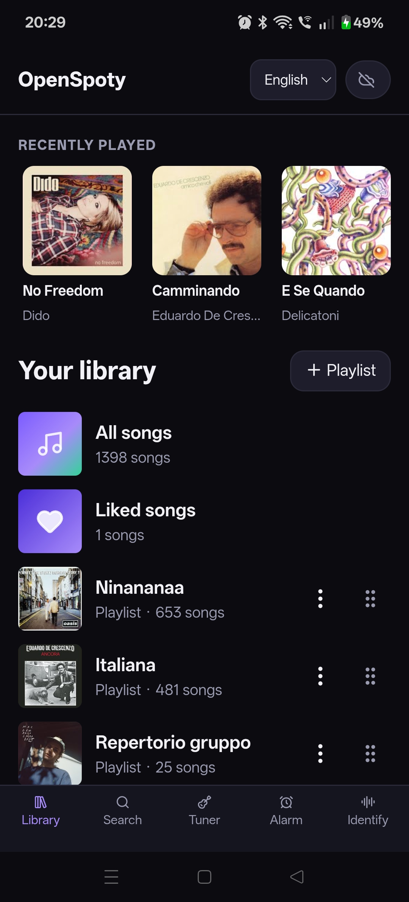
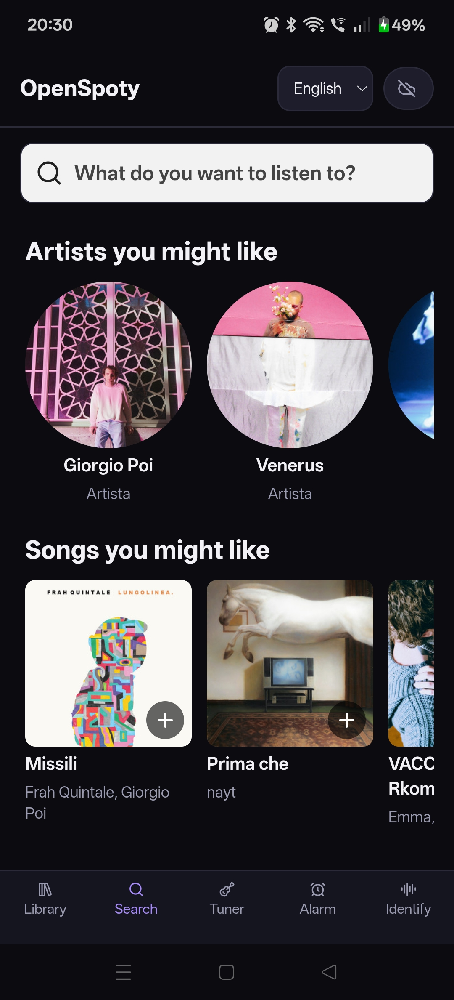
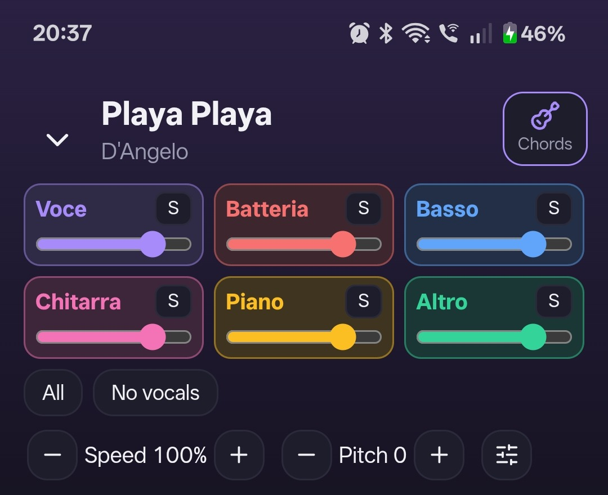
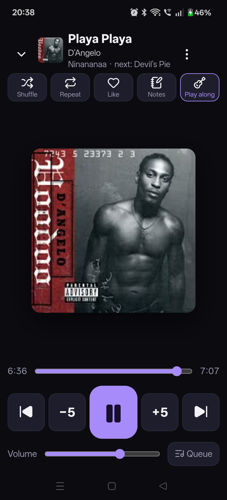
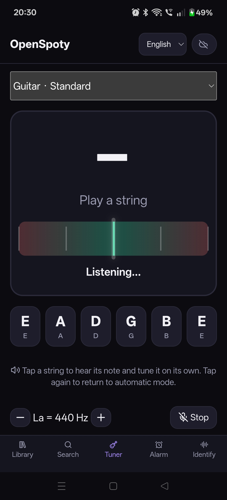
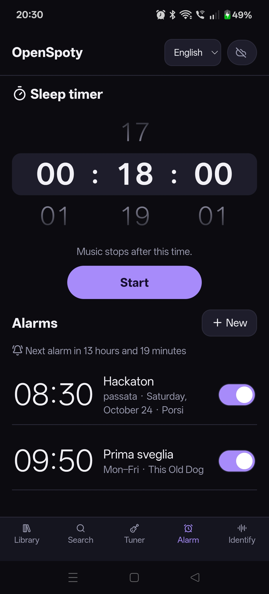
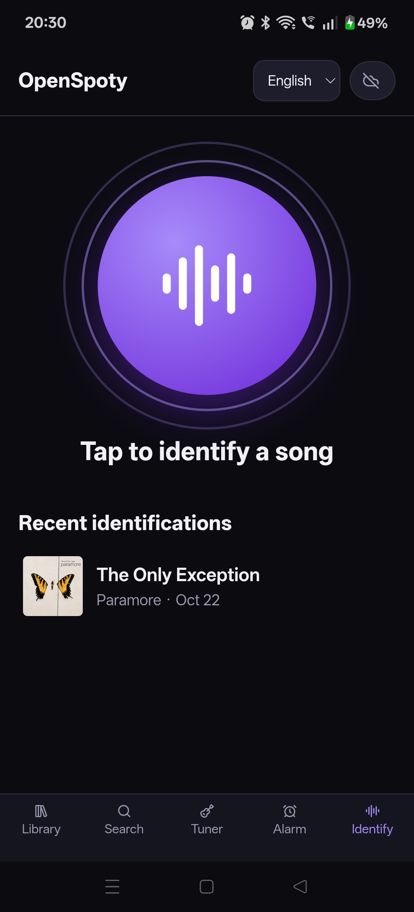

# OpenSpoty

**Free music streaming, built for musicians.** OpenSpoty lets you stream music for free and turn tracks into a practice space: load chords, follow synchronized lyrics, and control vocals and individual instruments independently. Available for Android and Windows.

> **Streaming, clearly explained:** OpenSpoty has no subscription fee. Music audio playback is provided through YouTube; Spotify is used for catalog metadata and artwork, not as the audio source. Availability and advertising depend on the source services. Use the integrations in line with their terms.

> **Languages:** The app interface is available in Italian and English. On first launch it follows the device language (Italian for Italian devices, English otherwise); you can change it from the in-app selector. Song titles, artist names, lyrics, transcripts, and user-created names remain in their source language. Other device languages currently use English.

[Leggi in italiano](README.it.md)

## Music streaming for free

Search for music, play it through YouTube, and organize your library with playlists and favorites. You can also import public Spotify playlists and albums; Spotify provides metadata and artwork while playback audio comes from YouTube.

 

Library Search

## Practice with the parts you need

OpenSpoty is designed for musicians as well as listeners. In Play Along, adjust the volume of vocals, drums, bass, guitar, piano, and other stems independently; mute or solo parts to focus on what you are practicing. Load chords and synchronized lyrics, edit chord positions, and change pitch or playback speed. BPM detection, count-in, and A–B looping help with focused practice.

 ù

Play Along controls (cropped before lyrics) Player Duplicate player capture

*The Play Along screen was captured before the final localization pass; the current app translates these controls when English is selected. The crop omits song lyrics.*

## More music tools

- **Tuner:** guitar, bass, and ukulele tuning, with automatic listening or manual string selection.
- **Music alarms and sleep timer:** wake up to a track or set playback to stop after a chosen time.
- **Song identification:** identify a song from nearby audio and revisit recent results.
- **Library extras:** notes, podcasts, offline downloads, and phone–PC synchronization on the same local network.

  

Tuner Alarms and timer Song identification

*Alarm titles and selected tracks are user-provided content and can remain in their original language.*

## Download and install

Download the Android APK or Windows package from [GitHub Releases](https://github.com/Jacoposchenetti/OpenSpoty/releases).

- **Android:** download the APK and open it on your phone. If prompted, allow installation from that source. The current v1.12.0 APK is a debug-signed tester build; updates must use the same signing key. OpenSpoty is distributed outside Google Play.
- **Windows:** download and extract `OpenSpoty-Windows.zip`, then run `OpenSpoty.exe`. Windows may ask you to confirm the first launch because the app is not signed with a commercial certificate.

To sync phone and PC, open the sync screen on both devices and enter the address and PIN shown by the PC app. Keep both devices on the same local network.

## How it works

OpenSpoty is built with React and Capacitor. Audio separation uses [StemKit](https://github.com/danielravina/stemkit) and Meta's six-stem HT-Demucs model. Separated stems are stored as lossless FLAC; the original track is not recompressed. Chords are inferred on-device, and pitch and speed changes use Signalsmith Stretch. Lyrics are provided by LRCLIB.

## Feedback

Trying the app? Please share what worked and what did not. For a bug report, include your device/OS, selected app language, steps to reproduce, and expected result in an [issue](https://github.com/Jacoposchenetti/OpenSpoty/issues). Feedback on translations and musician workflows is especially welcome. Avoid posting private or copyrighted media.

## Build from source

For Windows packaging, run `bash tools/pc/package.sh` from Git Bash with the required build tools installed. For Android development, open `app/` in Android Studio and use the Capacitor/Android toolchain. See the scripts under `tools/` for deployment details.

## License

OpenSpoty is licensed under [GPL-3.0](LICENSE). It includes third-party components under their respective licenses, including StemKit, HT-Demucs, BTC chord recognition, SongRec, Signalsmith Stretch, ONNX Runtime, and lucide. See the source tree and bundled license files for details.
